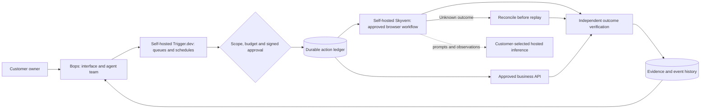
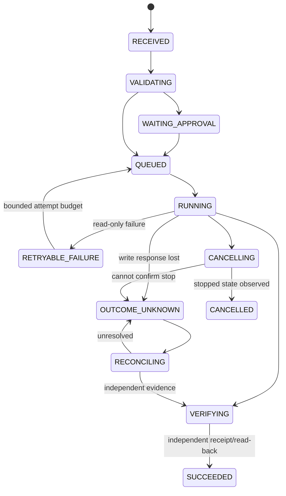

# Customer-owned workforce: workflow scaffold

## Open the visual map

Start the existing private application and open `/workflow-map` after owner login.
The map is read-only and protected by the same authentication boundary as Bops.
It does not submit tasks, approve actions, or display invented live telemetry.
Click any of 24 workflows, then a step, to see executor, timeout, retry limit,
evidence requirements and recovery instructions. The failure rehearsals are
explicitly marked SIMULATION and make no service requests.

To create a portable, offline HTML copy:

```sh
node private-runtime/workflows/export-control-map.mjs /absolute/path/workforce-map.html
```

The single source of truth is the compact `private-runtime/workflows/catalog.json`.
The contract expander materializes explicit per-step timeouts, retries and evidence.
`node --test private-runtime/test/orchestration.test.mjs` validates its 127 bounded
steps and the new adapter/control contracts. This is a starter operational
catalogue, not a claim to enumerate every possible business process.

## One execution path

There used to be two, with separate reservation stores: a filesystem journal plus
an owner CLI that posted to Skyvern's task API, and the Postgres-ledger Trigger
task. The same business action could therefore be submitted twice by two
mechanisms. The journal path (`ledger.mjs`, `skyvern.mjs`, `cli.mjs`) is retired.
`approve.mjs` survives because it only writes an approval file and never submits.

What remains, in dispatch order: `queue_workflow` (canonical id, allowlist,
credential check) -> owner approval in Bops -> `workforce-dispatch.mjs` signs
that exact action -> `trigger-client.mjs` performs one POST with the action key as
the Trigger idempotency key -> `ernesta-approved-browser-workflow` ->
`skyvern-client.mjs` -> `dispatchWriteOnce` -> `postgres-ledger.mjs`. Nothing else
submits, and the `/workflow-map` view reads that same catalogue.

## Architecture and ownership



Trigger is the orchestration engine. This scaffold does not reimplement a queue,
scheduler, checkpoint engine, browser agent or workflow designer. Skyvern provides
browser execution. Our small additions define the business contracts, scope and
approval boundary, safe submission identity, and interpretation of outcomes.
Existing Bops routines are unchanged; do not enable a second schedule for a job
when migrating it to Trigger. Customer deployments remain separate.

## What is runnable, and what remains a configuration/integration gate

* **Runnable now in this source:** authenticated read-only map, manifest validator,
  state/approval contracts, self-hosted Skyvern HTTP adapter, a PostgreSQL action
  reservation/receipt store, owner approval CLI, and a native Trigger task source.
* **Existing implementation base:** Bops private chat, Docker computers, delegation,
  routines, compaction and controlled egress. Earlier CI evidence belongs to its
  recorded commit, not to the new Trigger/Skyvern combination.
* **Not supplied by drawing a map:** customer connectors, actual published Skyvern
  workflows, credential references, verification handlers for each business action,
  target-service deployment, provider credentials, monitoring alerts and an
  authenticated owner-approval UI. Business recipes marked `mapped` have not been
  executed. The map is NOT a live execution dashboard.

The Trigger package is independently typechecked because it has its own SDK and
runtime dependencies. The root Next TypeScript project excludes that separate
package; the workflow-scaffold CI job checks it, rather than dropping coverage.
Its lockfile is emitted as an artifact for review. A complete deployment must
adopt a reviewed lockfile before treating builds as reproducible.

## Control states



Predictable means **bounded states, permissions, time, retries and recovery**.
It does not mean an LLM or a changing website cannot fail. A model cannot redefine
these control rules. A successful Trigger task may only mean dispatch/observation
finished. A Skyvern `completed` response becomes `VERIFYING`, never automatically
`SUCCEEDED`. Downstream verifiers must check the real message, receipt, record or
file. Their customer-specific implementations are not faked by this scaffold.

## Skyvern connection

Reviewed source: Skyvern commit `9ba3f1db5b52400146dd71955763a994086dd8f1`.
The adapter uses the documented backward-compatible `POST /run/workflows`,
`GET /runs/{id}`, and `POST /runs/{id}/cancel` routes beneath the configured API
prefix. It uses `workflow_id`, `parameters` and `run_metadata`; no unsupported
idempotency header is invented. Set the exact prefix from the deployed instance's
OpenAPI schema. The contract tests use a real local HTTP fixture, not a deployed
Skyvern service. Compatibility with the chosen deployed version must be tested.

`SKYVERN_API_BASE_URL` has no cloud default. HTTPS is required for remote control;
loopback and named `skyvern`/`trigger-webapp` Docker services may use HTTP inside
an operator-controlled network. A configured endpoint is not a firewall or proof
of deployment isolation. Keep API keys in server secret storage. The adapter
rejects credential-shaped parameter keys; this is not a perfect secrets/DLP scanner.
Use references, not passwords, cookies or keys, in workflow parameters.

Only explicitly allowlisted, pre-published workflow IDs can be submitted. Any
semantic change to a Skyvern workflow must use a new binding/version and approval.
`ai_fallback=false` disables that workflow-level fallback; it does not configure
Skyvern's internal model router. Configure model routing and egress independently
so that no OpenAI, Orgo or unapproved provider receives requests. Hosted inference
still receives prompts and selected observations.

The existing Bops proxy does not automatically contain a separate Skyvern container.
A Skyvern deployment needs its own tested browser/network isolation. Do not claim
that inheriting a hostname or a compose network proves equivalent controls.

## Submission, duplicate prevention and uncertain outcomes

`ledger.sql` is applied explicitly to a separate customer-owned application DB,
not to Trigger's internal database. It stores action identity and request hashes,
not browser credentials or full task payloads. Application code appends event rows;
this is not tamper-proof storage against a DB administrator.

1. Derive one stable action key from installation, workflow/version, business object
   and operation. Keep it across retries. Never mint a new key to hide uncertainty.
2. An owner-controlled process signs the exact request hash and expiry. Any changed
   recipient, amount or parameter invalidates it. The signing key must not reach
   models, browser workers or untrusted callers.
3. Commit the reservation before the external POST. If there is an existing remote
   ID, observe that run; do not submit another. An existing reservation without an
   ID is ambiguous and fails closed for reconciliation.
4. Record the returned remote ID. A timeout, malformed response, failed receipt
   write, or worker crash cannot trigger a blind second POST.
5. Resolve uncertainty by locating the remote run/receipt using the stored action
   metadata and verifying the destination state. Automated reconciliation is not
   implemented here. Never mark an ambiguous action "not executed" just because
   time passed. A new attempt requires proven non-execution and new approval.

This provides conservative replay protection, not an exactly-once guarantee for
external business systems. The unit tests exercise lost responses and concurrent
submission. A separate CI test uses real Postgres transactions and a new pool to
check persistence/replay, without making actual business writes.

## Native Trigger task scaffold

The separate package is `integrations/trigger`, pinned to SDK/CLI 4.8.3. Set the
customer-owned endpoint, project, ledger and Skyvern secrets via its `.env.example`
configuration. Disable telemetry on the Trigger webapp itself as well as workers.
Do not paste credentials in chat or commit generated environment files.

```sh
cd integrations/trigger
npm install --ignore-scripts
npm run check
# Authenticate the pinned CLI to YOUR self-hosted instance using its documented
# login/profile flow, then deploy only after the acceptance gates below pass.
# npm run dev
# npm run deploy
```

The task `ernesta-approved-browser-workflow` accepts a scoped approval and action,
reserves its identity, submits once or resumes a recorded run, and observes it.
Native retries are set to one attempt. Read failures can be resumed using the same
identity rather than replaying submission. The workflow has a ten-minute Skyvern
limit and an eleven-minute observation limit, within a twenty-minute task ceiling.
Self-hosted waits may retain compute; no cloud-only checkpoint behavior is assumed.

To produce a scoped approval in an owner-controlled terminal, load the signing key
and allowed workflow IDs from the secret manager, then:

```sh
node private-runtime/workflows/approve.mjs reviewed-action.json approved-task.json
```

The output is created mode 0600, never overwritten and never printed. It is a
sensitive action capability. Send it only to the corresponding customer-owned
Trigger project. The CLI is not an approval UI, and it does not itself send any task.

## Observable identifiers and failure ownership

Join records using installation_id, workflow_id/version, run_id, step_id,
action_key, trigger_run_id, skyvern_run_id and evidence_id. Do not put passwords,
cookies, raw authorization headers, unrestricted page text or personal data in
metric labels. Native self-hosted Trigger retains task inputs, including business
parameters and scoped grants; set access and retention accordingly. Store bulky
screenshots/documents in restricted artifact storage and reference them by ID/hash.

Recommended operational alerts are contracts to configure, not claimed active:
any OUTCOME_UNKNOWN action; a pending approval past deadline; a queue older than
its SLA; repeated provider failures; exhausted retry/budget; stale worker heartbeat;
failed verification; and a missing backup/restore drill. Each workflow names its
accountable owner and repair runbook in the catalogue.

## Activation gates

- Deploy customer-owned services with pinned images, secrets, restricted ingress,
  backups and measured capacity; install the application ledger migration.
- Publish and review Skyvern workflows, their allowed hosts, credentials and
  versioned bindings. Confirm no forbidden model or cloud fallback.
- Implement independent business verifiers and owner approvals for the recipes
  being activated. Do not activate the other mapped recipes by implication.
- Run live-provider, real-browser, crash/timeout, duplicate-delivery, cancellation,
  permission-denial and destination-receipt tests on the intended server.
- Assign one scheduler per workflow, an alert owner and a tested repair/rollback
  procedure. Only then enable production triggers.

No existing customer server, main branch, schedule, credentials or business account
is changed by adding this scaffold. Original Bops license/notices are preserved.
Trigger.dev's Apache license and Skyvern's AGPL license remain separate; using a
separate service is not a blanket statement that license obligations disappear.

## Source references

- https://github.com/Skyvern-AI/skyvern/tree/9ba3f1db5b52400146dd71955763a994086dd8f1
- https://github.com/Skyvern-AI/skyvern/blob/9ba3f1db5b52400146dd71955763a994086dd8f1/skyvern/client/types/workflow_run_request_output.py
- https://github.com/Skyvern-AI/skyvern/blob/9ba3f1db5b52400146dd71955763a994086dd8f1/skyvern/schemas/run_enums.py
- https://github.com/triggerdotdev/trigger.dev/releases/tag/v4.8.3
- https://trigger.dev/docs/self-hosting/overview
- https://github.com/ErnestaLabs/bops/pull/1
